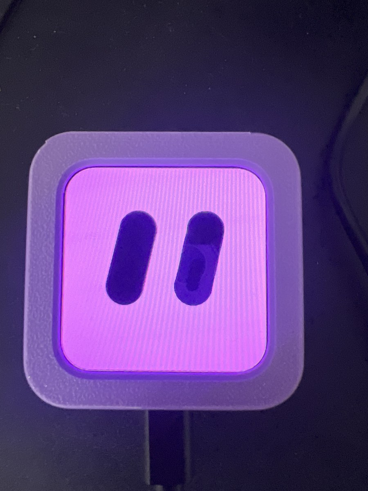
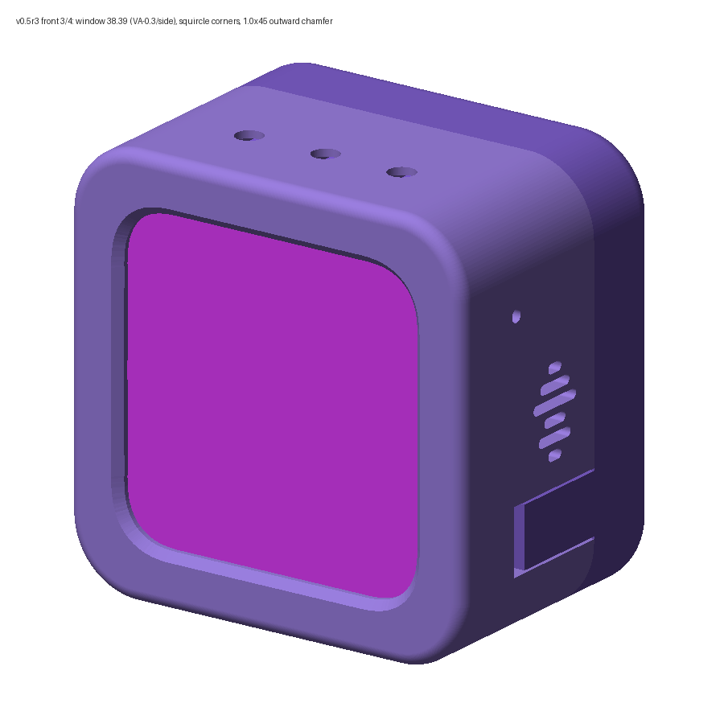
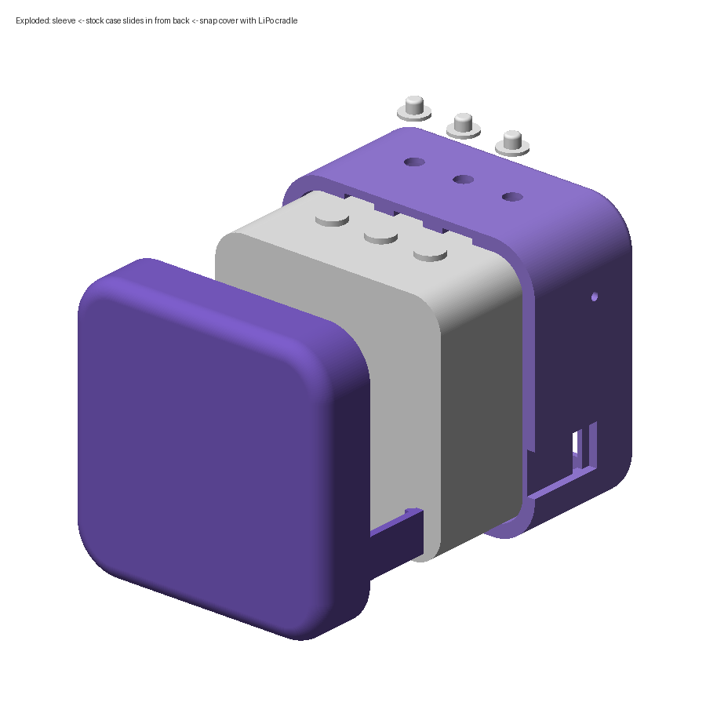

# Tamagroki

Tamagroki is a small 3D-printed cube you talk to. Say **"Yo Grok"** and it wakes up, opens its eyes, and you are having a real-time voice conversation with Grok. You can interrupt it mid-sentence. Say **"Bye Grok"** when you're done, or just stop talking and it falls asleep again.

<p align="center"></p>

| Front (CAD render) | Exploded (CAD render) |
|---|---|
|  |  |

It's a plain, general-purpose Grok voice chat with the persona "Tamagroki", and it can search the web (xAI's server-side `web_search` tool).

## How it works

```
 ┌──────── cube (ESP32-S3) ────────┐   Wi-Fi    ┌──────── Mac: relay/ ────────────┐   wss   ┌───────────────────┐
 │ "Yo Grok" wake word (MultiNet)   │──opus 16k─▶│ xiaozhi WS server + OTA endpoint │──pcm──▶│ xAI realtime voice │
 │ mic + AEC, realtime listening    │◀─opus 24k──│ server-VAD barge-in, pacing      │◀─pcm───│ (grok-voice)       │
 │ LVGL pill-eye face               │◀─face evts─│ web_search, idle sleep, "bye"    │        └───────────────────┘
 └──────────────────────────────────┘            └──────────────────────────────────┘
```

- **Body:** a Waveshare ESP32-S3-Touch-AMOLED-2.16 in a printed slide-in sleeve with a snap-on back plate that holds the battery.
- **Firmware** (`firmware/`): a modified [xiaozhi-esp32](https://github.com/78/xiaozhi-esp32) with a full-screen pill-eye face, the "Yo Grok" wake word, and audio tuning for this board.
- **Relay** (`relay/`): a small Python server on your Mac. It speaks xiaozhi's websocket protocol to the cube and bridges it to xAI's realtime voice API. Your xAI API key stays on the Mac and never goes to the device.

## Features

- **"Yo Grok" wake word**, on-device (ESP-SR MultiNet7, with a few spelling variants so it catches you reliably).
- **"Bye Grok"** ends the conversation right away, after a short goodbye.
- **15 s quiet sleep.** If you go quiet it goes back to sleep. The timer only counts while it's waiting on you: never while you're talking or while it's thinking or replying.
- **The face shows whether it's listening.** Asleep (closed eyes, "z z z") means it's only listening for the wake word. Awake eyes mean it's streaming to Grok. It also has listening, thinking and speaking animations, and the eyes bounce with its voice.
- **Barge-in:** talk over it and it stops and listens.
- **Picking it up doesn't wake it.** The IMU pick-up trigger is off by default.
- **Volume capped at 80%** (set by the relay on connect, `RELAY_DEVICE_VOLUME`) so the small speaker doesn't distort or echo into the mic.
- **Web search** for current info (set `TAMAGROKI_WEB_SEARCH=0` to turn it off).

## Parts

| Part | Notes |
|---|---|
| [Waveshare ESP32-S3-Touch-AMOLED-2.16](https://www.waveshare.com/esp32-s3-touch-amoled-2.16.htm) | 2.16" 480x480 AMOLED, ES8311 + ES7210 audio, speaker, mics, AXP2101 PMIC, QMI8658 IMU. Comes in a 46 x 46 x 22.5 mm stock case, which slides into the printed sleeve. |
| 803040 LiPo (3.7 V, ~1000 mAh) with a connector that fits the board's battery header | Sits in the back plate. Check the polarity before plugging it in. |
| PLA filament | About 15 g for the front sleeve and about 20 g for the back plate and button pins |
| USB-C cable | For flashing and charging |
| A Mac (or any machine with Python 3.10+) on the same Wi-Fi | Runs the relay |
| An xAI API key | From [console.x.ai](https://console.x.ai) |

<!-- TODO(Josh): parts photo -->
<!--  -->

## Printing the case

All files are in [`cad/`](cad/). The design notes and fit checks are in [`cad/NOTES.md`](cad/NOTES.md), and the parametric CadQuery source is [`cad/cube_v05r3.py`](cad/cube_v05r3.py).

| Part | File | Print |
|---|---|---|
| Front sleeve (v0.5 r3) | `cad/sleeve_r3_printorient.stl` (or `.step`) | Face down, no supports. About **41 min**, 15 g. Ready-sliced: `cad/print/tamagroki_v05r3_front_sleeve.gcode.3mf` |
| Back plate (v0.5 r2) | `cad/back_cover.stl` / `.step` | Stand it on its bottom face so the snap arms lie in-layer. Use small tree supports under the arm edges and posts. |
| Button pins (x3) | `cad/button_pin_x3.stl` / `.step` | Flat |
| Case back replacement (optional) | `cad/case_back_replacement.stl` / `.step` | Only if you replace the stock case back. Check it against your part. |

`cad/print/tamagroki_v05r2_sleeve_and_back.gcode.3mf` is the sliced r2 plate (sleeve + back plate). Use it for the back plate. The r3 sleeve replaces the r2 one.

**Settings** (Bambu X1C, Textured PEI, PLA): 0.12 mm layers, 0.2 mm first layer at 30 mm/s (first-layer walls at 20 mm/s), Arachne walls with thin-wall detection on, 3 walls, 15% infill, 5 mm brim, bed 65/60 °C, tree supports on the build plate only. Other printers work too. The front lip is thin (1.64 mm), so keep the first layer slow.

**Assembly:** it's a slide-in case with a snap-on back plate.
1. Hold the 3 button pins in their pockets (a bit of tape over the top helps).
2. Slide the board, in its stock case, into the sleeve from the back. The screen sits flat against the front lip.
3. Put the LiPo in the back plate, plug it in, and route the wire along the side.
4. Snap the back plate on. To open it, lift the snap-arm tips outward at the fingernail recesses.

<!-- TODO(Josh): assembly photos -->
<!--  -->

## Flashing the firmware

### Option A: build from source (recommended)

You need ESP-IDF **v6.1** (6.0.1 or newer):

```bash
mkdir -p ~/esp && cd ~/esp && git clone -b v6.1 --recursive https://github.com/espressif/esp-idf.git
cd esp-idf && ./install.sh esp32s3 && . ./export.sh
```

Plug the cube in over USB-C, then:

```bash
cd firmware
./flash.sh /dev/cu.usbmodem*      # builds with OTA URL http://<this-mac>.local:8765/xiaozhi/ota/, flashes, opens the monitor
# or use a fixed relay address:
TAMAGROKI_RELAY_URL=http://<relay-ip>:8765/xiaozhi/ota/ ./flash.sh /dev/cu.usbmodem*
```

`./build.sh` builds without flashing. The outputs land in `firmware/build/`.

### Option B: esptool with prebuilt binaries

If you have `xiaozhi.bin` (app), `generated_assets.bin` (assets, includes the wake-word model) and `ota_data_initial.bin` from a build:

```bash
pip install esptool
esptool.py --chip esp32s3 -p /dev/cu.usbmodemXXXX -b 921600 write-flash \
  0xd000   ota_data_initial.bin \
  0x20000  xiaozhi.bin \
  0x800000 generated_assets.bin
```

| Image | Offset |
|---|---|
| ota_data | `0xd000` |
| app | `0x20000` |
| assets | `0x800000` |

On a board that has never run xiaozhi, also write `0x0 bootloader/bootloader.bin` and `0x8000 partition_table/partition-table.bin` (or write the single `merged-binary.bin` at `0x0`, which also wipes saved Wi-Fi).

If the port doesn't show up, hold **BOOT**, tap **RESET/PWR**, release BOOT, and retry.

> **The board stays off after flashing.** After esptool resets it, the PMIC can leave it powered down, so the screen stays black. Press the **power button** to turn it on.

### First boot

The cube opens a Wi-Fi access point and shows its name. Join it from your phone, pick your Wi-Fi, and if needed set **Advanced → OTA URL** to the URL the relay prints (`http://<mac-ip>:8765/xiaozhi/ota/`). The cube then gets its websocket address from the relay. The relay never pushes firmware updates.

**Buttons:** BOOT click starts or stops a conversation. BOOT double-click toggles device AEC. Hold PWR for 4 s to power off.

To change the name, wake word, colour or eye tilt, see [`firmware/README.md`](firmware/README.md).

## Relay setup (Mac)

```bash
brew install python opus             # libopus is required
cd relay
cp .env.example .env                 # then edit .env and set XAI_API_KEY=<your key>
./run.sh                             # creates .venv on first run, prints the OTA URL for the cube
```

`.env` is gitignored, so never commit your key. When macOS asks, allow incoming connections for Python. Check it's up with `curl http://localhost:8765/health`.

| Variable | Default | What it does |
|---|---|---|
| `XAI_API_KEY` | (none) | Required |
| `TAMAGROKI_NAME` | `Tamagroki` | Name used in the voice persona |
| `XAI_VOICE` | `eve` | xAI voice id |
| `XAI_REALTIME_URL` | `wss://api.x.ai/v1/realtime?model=grok-voice-latest` | Realtime endpoint/model |
| `TAMAGROKI_IDLE_CLOSE_S` | `15` | Seconds of quiet (while waiting on you) before it goes back to sleep |
| `TAMAGROKI_GREET_ON_WAKE` | `0` | `1` = say a short hello after the wake word |
| `TAMAGROKI_WEB_SEARCH` | `1` | xAI server-side web search |
| `TAMAGROKI_EXTRA_INSTRUCTIONS` | (none) | Appended to the persona prompt |
| `RELAY_PORT` | `8765` | |
| `RELAY_DEVICE_TOKEN` | (none) | Optional shared secret the device must present |
| `RELAY_PUBLIC_WS_URL` | auto | Override the websocket URL handed to the device |
| `RELAY_DEVICE_VOLUME` | `80` | Speaker volume (0-100) set on connect |
| `RELAY_IN_GAIN` / `RELAY_OUT_GAIN` | `3` / `1.5` | Mic gain toward xAI / voice gain toward the cube |
| `RELAY_VAD_SILENCE_MS` | `900` | End-of-turn silence for xAI server VAD |

Tests (no hardware or API key needed, they use a mock cube and a mock xAI server):

```bash
cd relay && .venv/bin/python -m pytest -q
```

`tools/serial_log.py /dev/cu.usbmodemXXXX` captures the cube's serial log without resetting it (needs `pip install pyserial`).

## Troubleshooting

| Symptom | Try |
|---|---|
| Black screen after flashing | Press the power button (see above). |
| Port not found | Use a data-capable USB-C cable. Hold BOOT, tap RESET, release BOOT. |
| Face stays on "connecting" | The relay isn't reachable. Check `run.sh` is running, the Mac and cube are on the same Wi-Fi, the macOS firewall allows Python, and the OTA URL (Wi-Fi setup → Advanced) matches what the relay printed. `.local` names can fail on some routers, so use the IP. |
| Connects, then hangs up | Check the relay log for `XAI_API_KEY is not set` or an xAI error. `curl localhost:8765/health` shows `xai_key_set`. |
| Wake word misses you | Speak from within about 1 m and say it as two clear words: "yo · grok". Tune `CONFIG_CUSTOM_WAKE_WORD_THRESHOLD` (lower is more sensitive) in `firmware/tamagroki/sdkconfig.tamagroki`. |
| Wake word false-triggers | Raise the threshold, or remove spelling variants from `CONFIG_CUSTOM_WAKE_WORD`. |
| It cuts itself off / barges in on its own voice | Lower `RELAY_DEVICE_VOLUME` or `RELAY_OUT_GAIN`. |
| Grok can't hear you well | Raise `RELAY_IN_GAIN` a little (4-6). |
| Falls asleep too soon / too late | Change `TAMAGROKI_IDLE_CLOSE_S`. |
| Case too tight / screen border shows | See the fit notes in `cad/NOTES.md`. The clearances are parameters in `cube_v05r3.py`. |

## Photos

<!-- TODO(Josh): add photos to images/ (see images/README.md) and uncomment -->
<!--   -->

Face states from the desktop simulator (`firmware/sim/face`):


## Next version

**Connect Tamagroki to your own Grok Bots.** The plan is that you can hand tasks to your agents by voice ("Yo Grok, have my bot draft that email"). Tamagroki would pass the request to your Grok Bot and tell you the result. This comes once that fix is available. Until then, Tamagroki is a plain Grok voice chat.

## Repository layout

```
firmware/   modified xiaozhi-esp32 (vendored, MIT; see NOTICE.md)
  main/tamagroki/                 face, display glue, IMU, playback level
  tamagroki/sdkconfig.tamagroki   build preset (board, wake word, face)
  build.sh flash.sh test.sh
patches/    full diff of firmware/ against upstream xiaozhi-esp32 d7a1c05
relay/      Python relay (tamagroki_relay) + tests
cad/        v0.5 case: CadQuery source, STEP/STL, sliced 3MF, renders
tools/      serial_log.py
images/     photos (TODO)
```

## License

Josh Mills's own code, CAD and docs are under the MIT license ([`LICENSE`](LICENSE)). `firmware/` is based on xiaozhi-esp32 and stays under its original MIT license ([`firmware/LICENSE`](firmware/LICENSE)); see [`NOTICE.md`](NOTICE.md).
